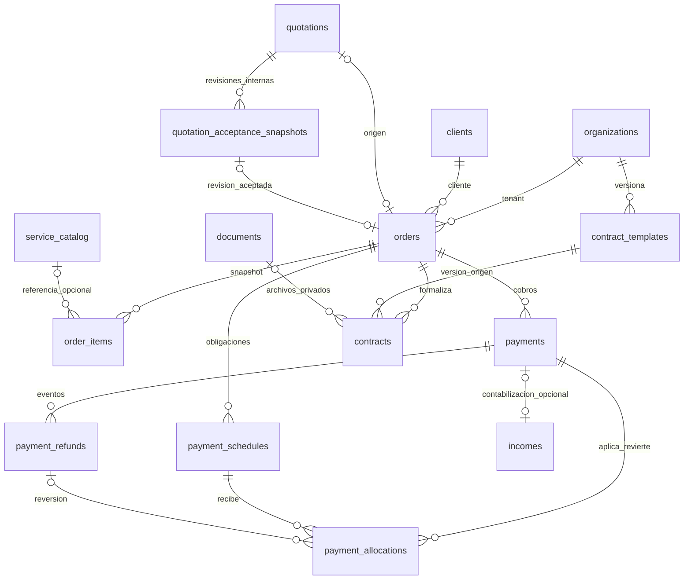

# NOVELI 2.0 — Phase 1: diseño revisado

Revisión 2, 2026-10-18. **PHASE 1 DESIGN REVIEW: PASS**. **READY TO IMPLEMENT PHASE 1A: YES**. **PRODUCTION CHANGES: NONE**.

Documento de diseño, sin SQL ejecutable, migraciones ni implementación. Sustituye la propuesta inicial; el alcance de Phase 1A es P1-01/P1-02, solo implementación local cuando se inicie ese trabajo. PASS significa revisión de diseño resuelta, no suites implementadas/pasadas ni autorización de producción.

Fuentes principales: [auditoría](CURRENT-MODEL-AUDIT.md). Los artefactos detallados de la revisión adversarial permanecen locales; decisiones normativas: [PHASE-1-DECISIONS.md](PHASE-1-DECISIONS.md). Hallazgos: [PHASE-1-DESIGN-REVIEW.md](PHASE-1-DESIGN-REVIEW.md). Pruebas: [PHASE-1-TEST-PLAN.md](PHASE-1-TEST-PLAN.md).

## 1. Alcance y convivencia

Order es la entidad comercial central. services conserva el expediente operativo; service_catalog y service_packs son oferta. No crear collaborator_payables ni settlements. No sustituir cotizaciones, clientes, ingresos, gastos, documentos ni Security 01–04B.

La evidencia previa contiene 4 clients, 10 prospects, 6 quotations (todas borrador), 1 quotation_item, 1 service, 10 catalog, 4 packs, 4 incomes, 10 income_allocations, 0 income_distributions, 13 expenses, 7 documents, 4 staff y 2 membresías admin. Son cifras de la captura auditada, no una nueva consulta productiva en esta revisión. Ninguna cotización actual se convierte automáticamente.

Datos Phase 1 usan exclusivamente sus columnas canónicas. Los aliases de clients/prospects/services y los importes contradictorios de quotation_items nunca se leen para recalcular una orden/pago nuevo. Conversión legacy requiere revisión explícita normalizada; no backfill ni COALESCE monetario entre aliases.

## 2. Diagrama

Las ocho tablas públicas nuevas son orders, order_items, payment_schedules, payments, payment_allocations, payment_refunds, contract_templates y contracts. Auxiliares internas no expuestas: contador de numeración, revisiones aceptadas de cotización y registro mínimo de capacidades por tenant (deshabilitadas por defecto). Las tablas legacy solo reciben las claves candidatas, coordinación de locks y el vínculo contable necesarios, sin eliminación de datos.

## 3. Modelo monetario canónico final

### Tipos y semántica

| Concepto | Columna canónica | Tipo SQL / regla |
|---|---|---|
| Moneda | currency en order y descendientes | text NOT NULL; Phase 1 activa CLP/USD; escala CLP=0, USD=2 |
| Cantidad | order_items.quantity | numeric(12,3), >0 |
| Precio unitario neto | order_items.unit_price | numeric(30,12), >=0; sin descuento ni impuesto |
| Residual de normalización | order_items.rounding_adjustment | numeric(18,2); servidor, absoluto <= una unidad mínima de moneda |
| Base neta antes de descuento | order_items.subtotal | numeric(18,2), >=0; redondeo(quantity×unit_price)+rounding_adjustment |
| Descuento neto | order_items.discount | numeric(18,2), 0<=discount<=subtotal |
| Impuesto monetario | order_items.tax | numeric(18,2), >=0 |
| Total de línea | order_items.total | numeric(18,2), subtotal-discount+tax |
| Totales comerciales | orders.subtotal/discount/tax/total | numeric(18,2); sumas exactas de líneas, mismas fórmulas |
| Tasa | order_items.tax_rate | numeric(7,4), 0..100; porcentaje, no fracción |
| Vencimiento | payment_schedules.expected_amount | numeric(18,2), >0 |
| Cobro bruto cliente | payments.gross_amount | numeric(18,2), >0 |
| Costo proveedor | payments.provider_fee | numeric(18,2), 0..gross_amount, misma moneda |
| Neto recibido | payments.net_amount | numeric(18,2), columna generada almacenada gross_amount-provider_fee; jamás input |
| Aplicación / devolución | payment_allocations.amount / payment_refunds.amount | numeric(18,2), >0; moneda compatible |

Los tipos finales admiten como máximo 16 dígitos enteros y 2 decimales; rechazar overflow, NaN/infinito, negativos indebidos y exceso de escala. Para Phase 1 el límite de negocio por orden/cobro/aplicación/refund es además 9.999.999.999,99, compatible con amount numeric(12,2) de incomes; en CLP el máximo entero es 9.999.999.999. No ensanchar columnas legacy ahora. Todos los importes CLP tienen fracción cero, aunque se almacenen con escala 2. Precio unitario puede tener más decimales; no es un importe liquidable. Toda aritmética autoritativa usa decimal de Postgres; JSON/API envía decimales como strings, sin depender de Number de JS. EUR permanece en algunos registros legacy pero no se activa en órdenes nuevas hasta revisar el CHECK contable y consumidores; no se corrige legacy.

### Algoritmo pricing_version=1

1. Redondeo a unidad mínima: nearest, empates alejándose de cero, fijo y versionado. No Math.round ni reglas por configuración mutable.
2. Para órdenes nuevas, precio neto×cantidad → subtotal de línea redondeado; rounding_adjustment=0. Ajuste de extensión forma parte del precio/base neta snapshot, nunca depende de catálogo después.
3. Descuento global se distribuye proporcionalmente entre subtotales elegibles en unidades mínimas, por largest remainder. Desempate position y luego UUID. Ninguna línea queda negativa; suma de descuentos es exactamente la aprobada. Si todas las bases son cero, solo descuento0 es válido y no se divide por cero.
4. Impuesto se calcula sobre base neta descontada. Agrupar por tasa/tratamiento; redondear impuesto del grupo y repartir unidades mínimas por largest remainder con mismo desempate. tax_mode guarda origen net/added/included/exempt; exempt exige tasa e impuesto cero.
5. Total de línea=subtotal-discount+tax. Cabecera suma líneas; no segundo cálculo independiente. Sumas se validan al finalizar comandos mediante constraint triggers diferidos. Los encabezados son snapshot materializado de la revisión comercial, no un saldo financiero mutable.
6. Para conversión de cotización antigua: un adaptador explícito versionado produce primero revisión canónica aprobada. Impuesto incluido se normaliza a neto; división puede necesitar rounding_adjustment acotado para conservar la base neta aprobada. Este residual es columna monetaria, no JSON libre; cualquier diferencia mayor exige revisión, no un “ajuste” oculto.
7. Snapshot guarda pricing_version, fuente, precios originales, modo/tasa, ajuste de extensión, política de descuento y redondeo. Metadata explica el cálculo; las columnas tipadas son la autoridad monetaria.
8. Verificar que total normalizado coincide exactamente con total aceptado. Si reglas legacy (por ejemplo redondeo entero USD) no se pueden normalizar sin cambiar el acuerdo, bloquear y solicitar una nueva aceptación canónica. No arrastrar errores de aliases para “hacer coincidir”.

Caso auditado obligatorio: base490000 + ajuste147000 = subtotal637000; discount0, tax121030, total758030 CLP. No copiar el price=0 ni gross_amount=0 legacy. Fee no es IVA, impuesto ni descuento de la Orden.

Convivencia: columnas legacy permanecen; ninguna sincronización automática a balances de clientes. Solo el adaptador de importación aprobado puede leer una cotización legacy; después el pricing histórico depende exclusivamente de snapshots nuevos.

## 4. Convenciones PK/FK, timestamps e índices

PK uuid; organization_id uuid NOT NULL FK organizations, tenant explícito validado. created_by uuid NOT NULL FK auth.users y created_at timestamptz del servidor, ambos inmutables. updated_at solo donde hay campos editables. Roles desconocidos/inactivos y anon no actúan. No usar staff.role ni user_metadata para autorizar.

Claves candidatas (organization_id,id) en padres; FKs compuestas evitan enlaces cruzados. En relaciones financieras incluir también order_id/currency cuando se repiten para integridad. El rol de aplicación no puede cambiar tenant ni identificadores de autoría. Los UUID de actores históricos usan RESTRICT, no cascada de borrado desde Auth.

CHECK/NOT NULL para invariantes de fila; UNIQUE/FK para identidad y relación; locks+triggers para topes/sumas entre filas. No CHECK con subquery. Fuente técnica: [Postgres constraints](https://www.postgresql.org/docs/17/ddl-constraints.html).

Índices mínimos: cada PK/UNIQUE y cada FK del lado hijo (reutilizando prefijos), órdenes tenant/created_at y tenant/client_id; cuotas tenant/order/sequence y tenant/lifecycle/due_date; cobros tenant/order/received_at y claves de idempotencia/identidad proveedor; aplicaciones tenant/payment y tenant/schedule; refunds tenant/payment y tenant/refund_key/event_sequence; contratos tenant/order/revision y tenant/status. No índices en columnas financieras derivadas inexistentes, ni GIN anticipado.

### Retención de referencias

| Relación | Acción de borrado |
|---|---|
| order→client / quotation / revisión aceptada | RESTRICT; historia vinculada no desaparece |
| item→order; schedule/payment→order; allocation→payment/schedule; refund→payment | RESTRICT |
| item→catalog / pack | SET NULL **solo catalog_id o pack_id**; organization_id nunca se pone NULL |
| contract→order / template / documents | RESTRICT |
| income→payment | RESTRICT, FK nullable para legacy |

SET NULL selectivo debe implementarse sobre la columna de referencia de la FK compuesta; no el SET NULL de todas las columnas. Desactivar catálogo se prefiere a borrar, pero si se borra la fuente, snapshot sigue completo. La única actualización permitida a item aceptado por esta causa es la nulificación referencial validada del catálogo/pack; no un cambio arbitrario de snapshot ni de updated_at comercial. IDs fuente originales conservados como provenance no-FK dentro de metadata. source_quotation_item_id es UUID histórico sin FK porque el flujo legacy elimina/recrea ítems.

## 5. Orders y snapshots de ítems

### orders

Campos: id, organization_id, client_id obligatorio, quotation_id opcional, quotation_acceptance_snapshot_id opcional, order_number, number_year, number_sequence; creation_operation_key uuid obligatorio y creation_request_hash; commercial_status, operational_status; currency, subtotal, discount, tax, total; pricing_version/pricing_metadata; accepted_at, accepted_by, acceptance_evidence; cancelled_at/cancelled_by/cancellation_reason; notes, internal_notes; created_by/created_at/updated_at.

**No columna física payment_status**, total_paid ni balance. Lectura mediante resumen financiero autorizado (§10).

UNIQUE(organization_id,order_number) y UNIQUE(organization_id,quotation_id) cuando quotation_id no NULL; una cotización no genera otra orden aunque se cancele la primera. Vínculo snapshot/quotation mismo tenant y mismo quotation por FK compuesta. Solo órdenes manuales pueden tener ambos campos de origen NULL.

Contador interno: PK(organization_id,year), last_value 0..999999. Creación de orden bloquea/actualiza esa fila atómicamente, incrementa y formatea NOV-ORD-YYYY-XXXXXX. Año UTC de emisión en servidor; no cambia después. Alta concurrente inicial mediante upsert atómico; no MAX()+1 ni secuencia en frontend. UNIQUE como última defensa; overflow bloquea. Número cancelado no se reutiliza; no se promete numeración sin huecos. UNIQUE tenant/creation_operation_key protege también altas manuales: retry idéntico devuelve orden sin otro número; hash distinto es conflicto.

accepted_by es el miembro que registra/verifica aceptación, no necesariamente el cliente firmante. acceptance_evidence conserva identidad/canal/referencia/fecha del aceptante comercial; accepted_at es instante de aceptación verificado y recorded_at queda trazable en auditoría. created_by es quien creó la orden. No inferir accepted_by desde quotation.user_id. Timestamps de ocurrencia verificados pueden ser anteriores al registro, no futuros; actor/fecha de registro siempre servidor.

No client_name/contact snapshot en orders: precio y alcance son el acuerdo; client FK inmutable al aceptar. Los datos legales que deben mantenerse históricos se congelan en contracts.party_snapshot. No renderizar un contrato histórico reconstruyendo el client actual.

Estados comerciales: draft→pending_acceptance→accepted; draft/pending_acceptance/accepted→cancelled solo por comandos. **No retorno a draft** desde pending_acceptance/accepted/cancelled en Phase 1. Para corregir una orden publicada se cancela cuando sus guards lo permitan y se crea otra; no se reemplaza la orden de una misma cotización ya convertida. Cancelar accepted exige retained_cash=0, ninguna transacción pendiente y ningún contrato signed; no refund automático. Contrato firmado necesita futura terminación/anexo, fuera de Phase 1.

Estados operativos: pending, preparing, in_progress, waiting_client, review, delivered, completed, paused, cancelled. Solo accepted puede pasar a preparing/in_progress/review/delivered/completed. Camino normal pending→preparing→in_progress→review→delivered→completed; review→in_progress y delivered→review permitidos antes de completed. waiting_client/paused desde preparing/in_progress/review con estado previo registrado y retorno explícito validado. completed/cancelled terminales en Phase 1. Comercial cancelled obliga operativo cancelled.

### order_items

Campos: id/tenant/actor/timestamps; order_id; position>0 único por orden; item_type; catalog_id o pack_id opcionales y mutuamente excluyentes; source_quotation_item_id opcional; name no vacío, description; quantity/unit_price/rounding_adjustment/subtotal/discount/tax/total/currency/tax_rate/tax_mode; pricing_version/pricing_metadata.

Vocabulario item_type preparado: noveli_service, collaborator_service, managed_project, digital_product; Phase 1 solo activa noveli_service. catalog_id referencia service_catalog, NO services (expediente). No service_id ambiguo. Servicio personalizado admite ambas fuentes NULL. Pack es una línea comercial; composición/nombres/alcance congelados en metadata, sin duplicar el monto en sublíneas.

Se congela todo el snapshot al salir de draft. Catálogo futuro no recalcula nombre, descripción ni importes. Aceptada: sin repricing ni cambiar cliente/moneda; corrección mediante nueva orden/acuerdo explícito. Permanece la excepción técnica de SET NULL de referencias fuente. FKs históricas no encadenan cascadas.

## 6. Payment schedules: saldo derivado, opción A

Recomendación final **A: paid_amount calculado**, en función/vista; no columna física ni cache por trigger.

Campos físicos: id/tenant/actor/timestamps, order_id, sequence integer>0 único por orden, currency, expected_amount, due_kind fixed_date/milestone, due_date date NULL solo para hito no calendarizado o draft, milestone_key opcional, lifecycle_status draft/scheduled/cancelled, published_at, cancelled_at/reason, label/notes.

sequence ordena cuotas, no se recicla después de publicación. fixed_date publicado exige due_date; milestone exige milestone_key no vacío. Al activar plan, suma de obligaciones scheduled=order.total. Orden gratuita no genera cuotas0. expected_amount es deuda bruta del cliente, no fee ni cash neto.

Lectura:
- paid_amount = suma apply menos reverse de allocations válidas.
- outstanding_amount=expected_amount-paid_amount.
- status = draft/cancelled según lifecycle; si scheduled: paid cuando paid_amount=expected_amount, partially_paid cuando 0<paid_amount<expected_amount, scheduled cuando paid_amount=0.
- is_overdue deriva de fecha de negocio UTC, due_date pasada y saldo>0, sin job ni estado persistido.

0<=paid_amount<=expected_amount; no permitir cambiar monto/moneda ni borrar una cuota publicada o con aplicaciones. Reprogramación completa queda fuera del primer comando; cancelar cuota publicada solo si su orden se cancela con retained_cash=0. No liberar una cuota aisladamente para desbalancear suma del plan. Permitir edición/reemplazo de cuotas draft aún no publicadas por comando, sin confundirlas con historia publicada.

## 7. Payments: cobro real y deduplicación

Campos: id/tenant/actor/timestamps; order_id; currency; gross_amount/provider_fee/net_amount generado; method transfer/card/cash/other; provider; provider_account_scope; provider_payment_id NULL; external_reference NULL; idempotency_key uuid; request_hash; received_at NULL hasta sucedido; status pending/succeeded/failed/cancelled; notes; evidence_document_id opcional FK compuesta documents.

net_amount=gross_amount-provider_fee se impone exactamente porque Phase 1 soporta solo cobro/fee/liquidación de misma moneda con fee conocido al confirmar. No estimar fee como0 si se desconoce; proveedor con FX, fee tardío, rebate o fee>gross no se activa bajo este contrato. Registro manual permite fee explícito0 verificado. Fee original no cambia por devolución.

status es explícito, transiciones solo por comando: pending→succeeded/failed/cancelled; terminales inmutables. succeeded requiere received_at y evidencia según método. Un refund no modifica status del payment ni sus importes. No modificar notes después de succeeded; correcciones explicativas como activity/evento adicional. No borrar pagos, ni pending.

external_reference es descriptiva y **NO UNIQUE**; puede repetirse entre pagos legítimos. Prevención de duplicados:
- UNIQUE tenant/idempotency_key para todo comando y comparación de hash del payload canónico.
- UNIQUE parcial (organization_id,provider,provider_account_scope,provider_payment_id) cuando provider_payment_id está informado; ID transacción estable, no número de boleta reutilizable.
- Scope de cuenta/periodo viene del contrato del proveedor y se valida servidor; no inventar scope con fecha de recepción para evadir deduplicación. Identificadores repetibles nunca se promueven a provider_payment_id.
- Proveedor sin ID inequívoco: Phase 1 registro manual con idempotencia y aviso de posible duplicado por referencia/monto/fecha, no bloqueo matemático de referencias reutilizables. No se afirma poder deduplicar cobros manuales sin identificador externo fiable.

Pago succeeded puede tener importe todavía sin asignar a cuotas de su propia orden. No rechazar un hecho real recibido por exceder el saldo: se conserva como unallocated_amount, no se inventa deuda adicional. Sin transferencias de crédito entre órdenes ni auto-charge. Orden debe estar accepted; cancelar requiere resolver incluso saldo no asignado.

## 8. Payment allocations final y refunds

### payment_allocations

Mínimo solicitado id, organization_id, payment_id, payment_schedule_id, amount, created_at, ampliado para integridad/historia con:
order_id, currency, created_by, direction apply/reverse, reversal_of_id NULL, refund_event_id NULL, operation_key uuid y operation_position integer>0.

amount siempre positivo. apply exige reversal_of_id/refund_event_id NULL; reverse exige ambos, refiere a un apply, mismo tenant/order/payment/schedule/currency y evento refund succeeded. Un refund puede revertir varios apply; UNIQUE refund_event_id/reversal_of_id evita replay. UNIQUE tenant/operation_key/operation_position. Sin UPDATE/DELETE. Solo efectos de pagos succeeded, nunca pending/failed.

Para payment p:
G=gross_amount si succeeded, R=sum refunds succeeded únicos, A=sum apply−reverse, U=G−R−A.
Invariantes: R<=G, 0<=A<=G−R, U>=0.
Para schedule s: 0<=sum apply−reverse<=expected_amount.
No confundir la suma bruta histórica apply con saldo efectivo tras refunds.

Aplicar pago puede distribuirlo entre varias cuotas; una cuota acepta varios pagos. No se exige A=G: U representa dinero sin asignar de esa orden. No usar net_amount como máximo aplicable: fee no disminuye lo que pagó el cliente.

Enforcement:
- CHECK fila para montos/direction/nulos.
- FK compuestas con tenant/order/currency a payment y schedule; FK del reverse al apply del mismo contexto, no solo uuid.
- Comandos y triggers de guard toman primero lock order, luego payments orden UUID, refund chain, schedules orden UUID. Toda mutación que afecte saldos toma ese mismo lock order, incluidos cambios de plan.
- Triggers diferidos validan sumas finales dentro de la transacción, luego de agregar payment/refund/aplicaciones. No usar una comprobación SUM aislada sin serializar escritores.
- RLS y revocación de DML directo impiden bypass desde API; el trigger conserva defensa ante una ruta de escritura interna futura.
- Reversos solo por refund exitoso en Phase 1; reasignación administrativa de fondos publicados fuera del alcance inicial.

### payment_refunds

Se mantiene historial estrictamente append-only mediante cadena de eventos:
id, organization_id, payment_id, currency, refund_key uuid, event_sequence integer>0, previous_event_id NULL, amount>0, reason no vacío, status requested/processing/succeeded/failed/cancelled, processed_at, provider_refund_id opcional, external_reference descriptiva, operation_key/request_hash, created_by/created_at.

Cada solicitud lógica refund_key admite múltiples eventos, pero amount/payment/currency/reason quedan fijos. Primero requested, luego processing opcional y terminal succeeded/failed/cancelled. UNIQUE tenant/refund_key/event_sequence, UNIQUE previous_event_id no NULL y primer evento único por refund_key evitan bifurcar. previous_event_id por FK compuesta a la misma cadena, pago y moneda. Terminal no tiene sucesor. Nunca UPDATE/DELETE; no borrar payment.

R cuenta solo el evento succeeded de cada refund_key, no requested+processing+succeeded como tres devoluciones. Reservas requested/processing vigentes más succeeded<=G bajo lock; reservar también el plan de reversión de esas solicitudes para no asignar sus fondos mientras esperan. La forma más simple Phase 1: mientras exista refund pendiente en un pago, bloquear nuevas aplicaciones y nuevas solicitudes sobre ese pago hasta resolverlo; varios refunds secuenciales sí permitidos. Cancelación/fallo libera reserva por evento.

Registro manual de devolución confirma resultado externo; no llama proveedor. Un comando terminal succeeded consume primero U y revierte el resto de aplicaciones seleccionadas de ese pago (por defecto últimas sequence primero). Suma reversos=MAX(0,refund.amount−U_previo). Todo ocurre en misma transacción; refund sin asignaciones no requiere reverse. U posterior y saldo de cuota nunca negativos.

provider_refund_id inequívoco se deduplica por tenant/provider/cuenta/ID como payment; su contexto se fija desde payment al crear cadena, y es inmutable. external_reference puede repetirse. Para deduplicar entre pagos del mismo proveedor/cuenta, lock transaccional del namespace y comprobación global servidor; un lock de pago aislado no alcanza. Integración automática de proveedores queda fuera de Phase 1; solo registro manual trazable.

Refund no devuelve automáticamente fee ni recalcula impuestos legacy: ambos necesitan documento/regla explícitos de contabilización. Retener original payment preserva historial de costo proveedor.

## 9. Estados: única fuente de verdad

| Campo expuesto | Persistencia / origen | ¿Editable? |
|---|---|---|
| orders.commercial_status | columna, máquina de estados por comando | Solo transición permitida |
| orders.operational_status | columna, transición operativa | Solo comando por rol |
| orders.payment_status | **no columna**; función resumen desde pagos/refunds | No |
| payment_schedules.lifecycle_status | columna draft/scheduled/cancelled | Solo comando |
| payment_schedules.status | derivado de lifecycle y allocations netas | No |
| payment_schedules.paid_amount | derivado de allocations | No |
| payments.status | columna, resultado real por comando | No CRUD libre; terminal inmutable |
| payment_refunds.status | evento append-only | Nueva fila por transición |
| contracts.status | columna, máquina de estados | Ninguna transición tras signed |
| contract_templates.active | columna, admin activa versión | Solo comando auditado |

Resumen de orden: G=suma gross succeeded, R=refunds succeeded, C=G−R (retained_cash), A=allocations netas, U=C−A.
Regla payment_status, en este orden:
1. Orden accepted/completada con total0: paid, salvo historial financiero inconsistente que debe bloquearse; sin crear pagos0.
2. G>0 y C=0 y R>0: refunded.
3. C>=order.total y total>0: paid, incluso si un refund anterior fue compensado por un nuevo pago.
4. 0<R<G y C<total: partially_refunded.
5. 0<C<total: partially_paid.
6. Resto: unpaid.

payment_status expresa cobertura monetaria de la orden; schedules.status expresa aplicación a obligaciones. Puede haber orden paid y cuotas pendientes si U>0; exponer allocation_gap y U a finanzas, nunca fingir cuotas pagadas. Refunds históricos se muestran además como refund_total/refund_status; no dejan una orden repagada permanentemente partially_refunded. Distinguir cancelled del estado de cobro; cancellation no borra historial.

## 10. RLS, API y matriz exacta

Todos los accesos exigen miembro activo del tenant explícito. Anon, inactive/unknown, otro tenant: cero filas/cero comandos. Admin no elude invariantes. is_org_finance gobierna transacciones financieras. Visualizador lee lo autorizado del área comercial, no el ledger financiero restringido por 03C.

Leyenda: R lectura de filas; C/I/U comandos acotados indicados; — sin acceso. **DML directo authenticated denegado en las ocho tablas. DELETE denegado a todos los roles**. La matriz describe permisos efectivos de SELECT/RPC, no grants CRUD amplios.

| Tabla | admin | editor | diseñador | corrector | finanzas | visualizador |
|---|---|---|---|---|---|---|
| orders | R+C+U comercial/operativo/cancelar | R+C+U comercial/operativo; no cancel accepted | R+U operativo | R+U operativo | R+U notes operativas | R |
| order_items | R+I/U en draft | R+I/U en draft | R | R | R | R |
| payment_schedules | R+C/U draft/publicar | — | — | — | R+C/U draft/publicar | — |
| payments | R+C/confirmar pending | — | — | — | R+C/confirmar pending | — |
| payment_allocations | R+append por comando | — | — | — | R+append por comando | — |
| payment_refunds | R+append requested/terminal | — | — | — | R+append requested/terminal | — |
| contract_templates | R+C versión/activar | R versiones publicadas | — | — | — | — |
| contracts | R+C/generar/enviar/aceptar/firmar/cancel no firmado | R+C/generar/enviar/cancel draft o generado | R | R | R | R |

Ningún editor cancela contrato accepted/signed, ni registra aceptación/firma. Finanza no firma contratos. Designer/corrector solo avanzan operación, no precios. Notes internas quedan visibles al equipo comercial del tenant, no al cliente ni web; no almacenar secretos ni notas financieras restringidas allí. Plantillas jamás actualizan contenido: nueva versión. Estas nuevas capacidades no cambian permisos legacy.

Cancelar cuotas publicadas es únicamente efecto interno de cancel_order autorizado a admin, no un permiso independiente de finanzas para cancelar una orden accepted. Cancelar órdenes draft/pending_acceptance propias del flujo comercial se permite a editor; accepted solo admin.

Protección técnica:
- RLS habilitada desde creación, permisiva por acción + barrera restrictiva tenant. Revocar defaults PUBLIC/anon y DML authenticated solo en objetos nuevos; no revocar globalmente esquema public.
- Funciones públicas invoker delegan a comandos internos no expuestos. Solo donde haga falta elevación, owner NOLOGIN/NOBYPASSRLS de privilegio mínimo, no propietario de tablas ni postgres; policies TO ese rol validan auth.uid/membresía/acción. EXECUTE revocado de PUBLIC/anon; authenticated solo entrypoints previstos, search_path vacío.
- El contador y revisiones internas no tienen SELECT/CRUD API; datos de revisión se obtienen solo vía comando autorizado. Usuarios no pueden invocar una operación genérica “escribir cualquier tabla”.
- Vistas del ledger usan security_invoker. **Una vista invoker de pagos no puede producir el resumen correcto para visualizador/editor**, porque su RLS no permite leer pagos. Resolver con función interna específica de agregado y owner mínimo, SELECT ledger autorizado solo a ese rol, valida visibilidad de order y retorna exclusivamente status/G−R permitido para resumen comercial. No devuelve fee/proveedor/transacciones ni se disfraza de vista invoker. Tests contra inferencia/IDOR y rol sin acceso obligatorios.
- Todas las escrituras guardan activity_log dentro de la transacción, actor/tenant servidor. No se toma activity_log como ledger inmutable.
- No service_role en navegador. El endpoint Storage usa secreto servidor solo en su flujo fijo y validado; no lo usa para autorizar comandos DB arbitrarios.

## 11. Quotation → order: RPC única, explícita e idempotente

Elegida: PostgreSQL function/RPC transaccional. Trigger solo para invariantes y coordinación de locks; no dispara creación de orden al cambiar un status. Frontend no ensambla varias llamadas para crear order/items/vínculo/log.

### Precondición de revisión canónica

Tabla interna quotation_acceptance_snapshots: id UUID, organization_id, quotation_id FK compuesta, revision_no único por quote, client_id, accepted_at, accepted_by, acceptance_evidence, canonical_pricing_version, snapshot JSONB validado de cabecera/ítems canónicos, snapshot_sha256, legacy_source_fingerprint, created_at/created_by. Filas inmutables, sin API directa. orders guarda FK a esa revisión. Es fuente aceptada para conversión, no alias de importes legacy.

Un comando opt-in save_and_accept_quotation guarda cabecera+ítems completos+revisión aceptada en **una transacción**, establece status legacy válido aceptada y accepted_at, y registra log. Para una cotización legacy ya aceptada sin revisión, un flujo explícito review_and_accept_quotation valida total/cliente/alcance y crea revisión con evidencia, sin aprobarla automáticamente. Todas las cotizaciones actuales siguen intactas hasta esa acción. Este mecanismo no cambia guards de edición existentes globalmente ni vuelve inválidos sus estados.

Añadir coordinación por parent-lock para escrituras quote/items (incluidos legacy) sin rechazo por modo nuevo: cada mutación toma la misma barrera de quotation. No se afirma que eso haga atómicos tres requests antiguos; la revisión inmutable sí separa una aceptación completa del estado intermedio. Si una edición legacy posterior cambia fingerprint, nueva conversión exige una nueva aceptación completa. Si llega después del commit de conversión, no cambia el snapshot de la orden ya creada.

### Una llamada convert_quotation_to_order

Entrada: organization_id, quotation_id, acceptance_snapshot_id, expected_snapshot_sha256, idempotency_key. Cliente/moneda/importes provienen de revisión aprobada, no parámetros arbitrarios de conversión.

1. Verificar auth.uid, membresía activa y rol comercial admin/editor; lock quotation de ese tenant.
2. Buscar order por tenant/quotation. Si existe y coincide revisión/huella de solicitud, devolver misma order/id/número incluso cancelada. No crear log/contador extra. Si parámetros distintos, conflicto, no devolver éxito ambiguo.
3. Si no existe: verificar quote aceptada, accepted_at, revisión vigente de mismo tenant/quote/client, huella; lock revisión, cliente y todos ítems relevantes. La coordinación de escrituras quote/items impide agregar ítems nuevos mientras se verifica fingerprint.
4. Validar fuente sigue coincidiendo, revisión tiene al menos un ítem, cliente inequívoco y mismo tenant, moneda/formato/aritmética/sumas/campos snapshot válidos. No resolver cliente por email o author_name.
5. Incrementar contador tenant/año y crear order accepted con accepted_by/evidence preservados, created_by del actor que convierte, operational pending. pricing derivado solo de la revisión aprobada.
6. Copiar todas las líneas canónicas a order_items conservando provenance source_quotation_item_id. No FK a ítem legacy efímero ni lectura de precio actual de catálogo.
7. Guardar en esa order quotation_id + acceptance_snapshot_id; ambas FK coherentes son el vínculo bidireccional consultable. No duplicar order_id en quotations. No tocar flags converted_to_prospect/client/service. Estado pertinente de la orden queda accepted; quotation permanece aceptada, no “convertida” inválido.
8. Registrar activity_log único de conversión con order_id y referencia quote/snapshot; log obligatorio. No crear prospecto/servicio/ingreso/pago.
9. Verificar invariantes finales y commit; cualquier error revierte order/items/contador/log. Retry de timeout devuelve la orden creada, no una segunda orden.

UNIQUE tenant/quotation es defensa final contra dos conversiones. El lock de quotation serializa solicitudes. Idempotencia se fija por quotation+snapshot y por las columnas **orders.creation_operation_key / creation_request_hash**, compartidas con alta manual y protegidas por UNIQUE(organization_id,creation_operation_key). Clave reutilizada entre cotizaciones distintas o entre alta manual/conversión produce conflicto, no depende de comparación UI. Un retry con nueva key pero mismo quotation/snapshot recupera la orden ya existente por identidad del origen, sin generar número nuevo.

Ninguna función depende de frontend ya actualizado para que una migración pueda instalarse: sin revisión explícita rechaza conversión sin side effects; el guardado legacy continúa. Las funciones nuevas están inactivas hasta autorización de activación, no interfieren en los flujos actuales.

## 12. Contracts y templates

### contract_templates

id/tenant/actor/created_at; template_key, contract_type inicialmente noveli_service, version integer>0; name/content/content_format markdown o html sanitizado; variables_schema objeto versionado; content_sha256; active boolean.

UNIQUE tenant/template_key/version; a lo sumo una active por familia. Contenido/variables/formato/nombre/tipo/versión/hash inmutables desde creación; admin publica otra fila. active es único cambio permitido por comando con auditoría. Una versión publicada alguna vez conserva published_at inmutable; editor SELECT solo published_at no NULL, incluidas versiones antiguas inactivas. No DELETE, incluso nunca usada: desactivar evita ambigüedad de reutilizar versiones.

### contracts

id/tenant/actor/timestamps; order_id obligatorio FK, template_id obligatorio FK; revision>0 único por order; status draft/generated/sent/accepted/signed/declined/cancelled; template_snapshot, party_snapshot, order_snapshot, rendered_content/content_sha256, rendering_version; generated_document_id/signed_document_id; generated_file_sha256/signed_file_sha256; generated_at/sent_at/accepted_at/signed_at/declined_at/cancelled_at; generated_by/sent_by/accepted_by/signed_recorded_by según transición; acceptance_evidence; supersedes_contract_id opcional mismo order.

Client se obtiene por order FK, no segunda columna client_id editable. party_snapshot congela nombres legales, identificadores, domicilio y representación utilizados; template_snapshot contiene texto completo, variables, versión/formato/hash; order_snapshot congela número, ítems y condiciones comerciales exactas. No referencia a plantilla mutable para regenerar contrato histórico.

Draft puede tener rendered_content y hashes/document refs NULL; generated exige texto, snapshot completo y documento/hash generado. signed exige archivo firmado/hash, evidencia verificada, signed_at y actor que registra; no reutilizar checkbox legacy como firma. Transiciones draft→generated→sent→accepted→signed, sent→signed con accepted_at/evidence; generated/sent→declined; cancel no firmado según rol. Nada terminal se reabre. Un contrato vigente por orden, índice único parcial excluye declined/cancelled; signed siempre ocupa ese lugar. Anexos/terminación de signed posteriores fuera de alcance.

Después de signed, **ninguna columna de contracts puede actualizarse**, incluido updated_at, notes, signed_at, referencias y snapshots. Trigger BEFORE UPDATE/DELETE rechaza incluso admin; no hacer excepción de “metadata menor”. Envíos adicionales/observaciones se registran como actividad aparte, sin mutar fila firmada. Inmutabilidad del snapshot generado también impide ediciones legales silenciosas después de generated: revisión nueva para otro texto.

## 13. Inmutabilidad de Storage y metadata firmada

Path final exclusivo: tenant_uuid/contracts/contract_uuid/revision_uuid/generated/file_uuid.pdf o signed/file_uuid.pdf. UUID nuevos, bucket documents privado, sin URLs persistidas. El prefijo contracts se reserva; objetos anteriores fuera del prefijo no se alteran.

1. Upload solo endpoint servidor validado, upsert=false, create-only; nunca método genérico para overwrite/move/delete. Un path existente produce error, no reemplazo.
2. Nueva policy RESTRICTIVE de storage.objects para INSERT/UPDATE/DELETE authenticated impide escribir ese prefijo. UPDATE evalúa old y new: no mover/renombrar hacia ni desde él, ni cambiar bucket. Policies 04B permanecen, sin nuevos permisos ni public flags.
3. No UPDATE/DELETE de storage.objects vía SQL de aplicación para simular protección: bytes se manejan por API Storage, policy es el control de autorización. Añadir validación defensiva de metadata en public.documents para este prefijo desde creación y para cualquier documento contractual congelado: path/tenant/tipo/tamaño/MIME/refs inmutables, sin DELETE. Archivo signed no puede referenciar path fuera del prefijo protegido.
4. Signed URL se emite con sesión autorizada y TTL300. Cero public fallback. El cliente no puede “firmar” aportando document_id ajeno del tenant u otra revisión.
5. Generación/subida fuera de transacción DB usa reservation durable en contract draft con campos de proceso acotados previos a generated, path nuevo y op key. Retry misma operación recupera bytes o aborta si hash distinto; no deja contrato signed con referencia inexistente.
6. Endpoint descarga por API el objeto final, calcula SHA-256 sobre bytes, verifica MIME/tamaño/path/bucket/tenant/revisión y compara manifiesto esperado. Guarda size_bytes bigint, mime_type text y bucket/path/version UUID junto al hash en el snapshot protegido de archivo. Al sign, verifica **archivo generado y firmado**, vincula documentos y cierra metadata/row en transacción DB. No confiar en ETag como SHA-256.
7. TOCTOU: upload final create-only y sin ruta de mutación para usuarios/endpoint permiten verificar antes de commit. El endpoint no tiene acción overwrite aunque su secreto pueda técnicamente saltarse RLS. Job admin con service_role o operador privilegiado sigue pudiendo cambiar bytes fuera de este modelo: no es WORM criptográfico/legal. Backup y detección periódica hash para recuperación, sin prometer protección frente a dueño de plataforma.
8. No limpieza automática de huérfanos, originals ni bytes productivos. Fallo de DB tras upload conserva objeto no vinculado para revisión; no lo sobrescribe ni lo elimina para ocultar error.

Document metadata congelada al generated evita modificar hash/path entre generar y firmar. La lectura sigue al modelo tenant actual; la revisión no agrega restricciones de lectura de documentos legacy ni acceso público a contratos.

## 14. Payments → incomes: dirección final

**FK única y nullable incomes.payment_id → payments.id**, compuesta con organization_id, UNIQUE tenant/payment_id no NULL, RESTRICT. Payment no guarda income_id. No tabla puente ni doble FK circular. Ingresos legacy conservan payment_id=NULL; no emparejar por cliente/monto/fecha.

Un payment succeeded puede existir operativo antes de contabilizarse. Comando explícito post_payment_to_income, solo admin/finanzas, lock payment + idempotencia, crea como máximo un income y activity_log en la misma transacción. Si ya existe devuelve ese income; si no succeeded rechaza. Posting no cambia payment. Estado de conciliación unposted/posted es derivado de existencia FK, no bandera duplicada.

Proyección de income ligado: amount=gross_amount en moneda pago, client_id derivado de order.client_id, fecha received_at, source_type phase1_payment; provider_fee y net no se reinterpretan desde aliases legacy. Datos financieros de ese income no se editan ni se borra después de enlazarlo; guard nuevo solo afecta filas payment_id no NULL. Corrección mediante ledger, nunca quitar vínculo y repostear.

Compatibilidad de posting: incomes.amount y value_converted actuales son numeric(12,2), y currency solo CLP/USD. Aplicar límites antes del cast; si rate×gross no cabe en value_converted, abortar posting completo y dejar payment visible como unposted, sin truncamiento, sin income parcial ni alterar payment. CLP usa exchange_rate=1. USD requiere accounting_exchange_rate>0, rate_date y fuente de tasa aportadas/verificadas explícitamente para esa contabilización; persistirlas como snapshot de reporting. Esta conversión de reporte a CLP no cambia moneda, importe ni fee del pago. No obtenerla de un alias contradictorio ni de tasa mutable en cada lectura. No mapear incomes.net_amount al neto de proveedor: ese alias legacy puede representar neto tributario y no es canónico; la vista usa nombres explícitos payment_net_cash/provider_cost/tax_from_order. Lectores legacy no compatibles con esas distinciones mantienen bloqueada la activación nueva.

Reporting financiero nuevo toma **incomes una sola vez**, left join a payment vinculado para gross/fee/net y refunds succeeded. No UNION que sume payment e income como dos ingresos. Para income legacy usa semántica actual sin intentar reconstruir fee. Para vinculado distingue gross_sale, provider_cost, cash_received=net_amount y cash_refunded; cash_after_refunds=net_amount−refunds. Refund completo con fee no reembolsable deja cash_after_refunds=−fee, resultado correcto de caja. Refund no crea segundo income negativo ni expenses automático.

Ingresos operativos sin posting se muestran en reporte de conciliación, separados de contabilizados. No habilitar captura productiva antes de tener esa reconciliación y lectores financieros compatibles: Dashboard/Reports/Taxes/CompletedSales/Clientes no deben sumar aliases ni tratar neto como base tributaria. Este diseño no inventa tratamiento fiscal de fee/refunds; módulos de impuestos necesitan proyección explícita de base/impuesto del acuerdo y ajustes respaldados, fuera de Phase 1A. No se declara cierre contable fiscal solo por existir payment/income.

Si se crea income antes de refund, no se modifica amount para esconder devolución: proyección consulta ledger. Si se contabiliza después, registra gross original y muestra refunds ya ocurridos. Referencia de income legacy no permite crear payment automáticamente. Sincronizar datos contables no convierte columnas legacy en source of truth de órdenes/pagos.

## 15. DELETE y cancelación

Decisión conservadora: **ninguna de las ocho tablas tiene DELETE físico desde aplicación**, ni admin, incluidos draft/pending. Orden draft se cancela; ítems draft se reemplazan solo mediante comando de edición de revisión antes de publicar (DELETE interno acotado permitido únicamente para esos ítems draft sin vínculos históricos); nunca DELETE directo por rol. No permitir esa excepción a item que alguna vez salió de draft.

Schedules draft aún no publicados y sin allocations pueden reemplazarse internamente en un set_plan atómico; una vez publicados no se borran. El resto:
- accepted order, payment de cualquier estado, allocation, refund de cualquier estado, contrato de cualquier estado: conservar.
- signed contract sin UPDATE/DELETE, excepción ninguna.
- template: desactivar, mantener versión usada o no.
- contador, revisión aceptada, registro de idempotencia: no borrar para reutilizar identificadores.

No se permite volver de pending_acceptance a draft; la edición con reemplazo interno de líneas solo existe para borrador que nunca se publicó. El historial de revisiones de órdenes publicadas es una extensión posterior. Para corrección se usa cancelación y nueva orden manual documentada, o una nueva cotización; nunca crear una segunda orden desde la cotización original.

Ninguna cascada elimina historia financiera/contractual. Acciones operativas irreversibles se registran y cambian estado, no borran.

## 16. Diez migraciones definitivas, sin escribirlas

Cada lote incluye seguridad, constraints e índices de sus propios objetos; no dejar RLS para el final. Los nombres siguientes son rótulos, no filenames ni timestamps.

| Orden | Propósito único | Contenido y validación aislada | Compatibilidad |
|---|---|---|---|
| P1-01 Fundamentos tenant/numeración | Infraestructura interna | Claves candidatas necesarias en padres, contador y roles mínimos no expuestos; aislamiento y secuencia concurrente | Sin cambiar datos/defaults/roles legacy |
| P1-02 Órdenes y pricing | Dominio comercial manual | orders/items, snapshots canónicos, RLS, comandos manuales y resumen básico sin pagos aún; tests pricing/roles/número | Sin writes a legacy; Phase 1A termina aquí |
| P1-03 Conversión explícita | Dominio quotation→order | Revisiones aceptadas internas, aceptación/guardado atómico opt-in, barrera locks quote/items, RPC conversión | No fuerza nuevo flujo al frontend actual; sin revisión rechaza |
| P1-04 Calendario de obligaciones | payment_schedules | Tabla, plan draft/publicación, RLS/índices; paid_amount0 hasta existir ledger | No toca ingresos ni habilita cobros; no cambia plans legacy |
| P1-05 Estructura ledger | payments/refunds/allocations | Tres tablas mutuamente relacionadas, FK/CHECK/append-only y topes diferidos; sin comandos de escritura API habilitados | Deny DML directo; validar con fixtures locales bajo rol interno |
| P1-06 Comandos ledger | Registrar/aplicar/devolver | Entry points, locks, idempotencia, cálculo de cuotas y resumen; pruebas de carreras | Capacidad de cobro default false, sin tocar consumidores actuales |
| P1-07 Conciliación con incomes | Dirección contable única | FK nullable/unique payment_id, posting idempotente, proyección y guards solo filas enlazadas | Legacy NULL intacto, no backfill ni cambio global de reportes |
| P1-08 Modelo contractual | Templates/contracts | Versionado/snapshots/inmutabilidad/RLS; generación-firma DB aún no expuesta | No toca contratos/URLs legacy |
| P1-09 Protección de archivos contractuales | Seguridad de bytes/metadata | Barreras de prefijo y documents, validadores de refs/hash | Solo prefijo nuevo; no ampliar ni reemplazar 04B |
| P1-10 Comandos contractuales | Finalización de contratos | Entry points de generated/sent/accept/sign con attestación servidor; pruebas de estados/evidencia | Deshabilitados hasta endpoint verificador disponible |

La propuesta de ocho lotes crece a diez para separar calendario, estructura de ledger y comandos de ledger. P1-05 conserva tres tablas juntas por el vínculo refund/reversal, pero no incluye endpoints ni posting contable; instala toda su seguridad desde el principio. Hasta P1-06 las lecturas sin ledger devuelven cobrado0 (no deuda0), con la regla de orden gratuita preservada, porque no hay un camino de escritura habilitado para crear pagos. Desde P1-05 cualquier lectura financiera disponible consulta ya el ledger real; no se conserva un stub que oculte fixtures/datos. P1-06 habilita entrypoints controlados por flag y completa las funciones de agregado autorizadas.

Todas se instalan y prueban con frontend actual sin cambiarlo. Habilitación de captura/conversión/contratos es **release separado**, no efecto colateral de aplicar DDL. Gate interno de capacidades por tenant default false y solo servidor/admin de despliegue puede habilitar; ningún rol de UI puede activar en producción. P1-01 define ese registro mínimo privado para capacidades, el resto respeta flags; lecturas históricas no se deshabilitan al cerrar una capacidad.

No hay migración “activar todo” dependiente de frontend aún no desplegado. Antes de release: código de consumidores financieros/quote actualizado, endpoint Storage verificador disponible y suites de compatibilidad pasadas. No hay SQL ni migraciones creadas en esta revisión. Producción requiere autorización separada.

## 17. Criterios de cierre y límites

El [plan de pruebas](PHASE-1-TEST-PLAN.md) es obligatorio antes de implementar: rollback completo, concurrencia real en sesiones distintas, snapshots y redondeos, allocations/refunds, RLS y endpoints Storage. No se han ejecutado pruebas de un modelo inexistente ni nuevos smokes productivos en esta revisión documental.

Fuera de Phase 1A: proveedor de pago automático, FX, crédito entre órdenes, fee diferido/rebate, anexos/terminación contractual, red colaboradores, borrado de huérfanos, backfill financiero. Overpayment se conserva como U en la misma orden, no se pierde un hecho real.

Las fuentes técnicas consultadas explican límites de constraints, locks, RLS y Storage; no constituyen evidencia de que la implementación futura pase pruebas: [Postgres locks](https://www.postgresql.org/docs/17/explicit-locking.html), [Supabase RLS](https://supabase.com/docs/guides/database/postgres/row-level-security), [Storage access control](https://supabase.com/docs/guides/storage/security/access-control).

**PHASE 1 DESIGN REVIEW: PASS** 
**READY TO IMPLEMENT PHASE 1A: YES** 
**PRODUCTION CHANGES: NONE**
